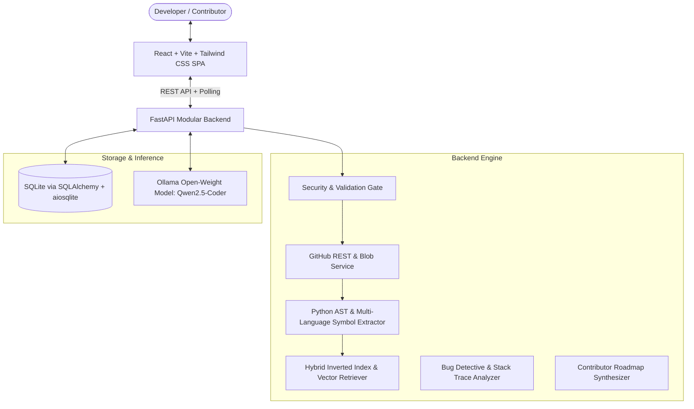

# RepoMedic AI — Architectural Specification

RepoMedic AI is an open-source, developer-first diagnostic workspace designed to help engineers, open-source contributors, and teams rapidly understand, navigate, and debug unfamiliar codebases.

---

## 1. High-Level System Architecture

---

## 2. Core Subsystems

### A. Repository Ingestion & Safety Engine
- **GitHub REST API Client**: Safely retrieves tree structures and blobs under strict limits (`MAX_REPOSITORY_FILES = 500`, `MAX_FILE_SIZE_KB = 500`, `MAX_TOTAL_CONTENT_MB = 20`).
- **Path Traversal & Boundary Defense**: Sanitizes file paths using POSIX path resolution, forbidding null-bytes, root directory escapes (`..`), and absolute paths.
- **Sensitive File Exclusion**: Rejects `.env*`, `id_rsa`, `*.pem`, `*.key`, `*.pfx`, and scans content against API secret patterns (`AKIA...`, `ghp_...`, `sk-...`).

### B. Structural & AST Code Indexing
- **Python AST Parser**: Dissects Python source into classes, methods, functions, docstrings, and import hierarchies.
- **Multi-Language Symbol Matcher**: Uses regex patterns to identify class, function, and export declarations in TypeScript, JavaScript, Go, Rust, Java, and C++.
- **Framework Signature Detection**: Automatically detects frameworks (FastAPI, Flask, Django, React, Next.js, Vue, Express, Spring Boot) via import analysis and manifest checks.

### C. Hybrid Retrieval-Augmented Generation (RAG)
1. **Query Normalization**: Deconstructs natural language queries, snake_case identifiers, and camelCase tokens.
2. **Multi-Signal Ranking**:
   - Boosts exact AST symbol matches (classes and functions).
   - Weights file path mentions.
   - Computes BM25 sublinear term frequency scores across code chunks.
3. **Prompt Injection Defense**: Untrusted repository snippets are isolated inside `<untrusted_repository_content>` tags, sanitized, and fed into open-weight models with a strict grounding system prompt.
4. **Deterministic Fallback**: If Ollama is offline or the configured model is not pulled, RepoMedic executes deterministic code-based synthesis, returning grounded code snippets, exact lines, and AST definitions without failing.

### D. AI Bug Detective & Diff Engine
- **Stack Trace Parser**: Parses Python, JavaScript/TypeScript, and Go stack frames to pinpoint error files, line numbers, and function scopes.
- **Target Snippet Extraction**: Automatically retrieves context surrounding the offending frame.
- **Unified Diff Generation**: Creates standard unified patch proposals (`difflib`) alongside side-by-side comparisons, side effects analysis, and verification steps.
- **Non-Destructive Guarantee**: Generated patches are presented for review; RepoMedic AI never mutates user files or commits to Git automatically.

---

## 3. Data Model (SQLite)

- `repositories`: Stores owner, name, default branch, stars, forks, detected primary languages, frameworks, README summary, and risk signals.
- `indexed_files`: Stores normalized relative paths, languages, line counts, sizes, sanitized source code, and AST symbol tables.
- `questions`: Stores query history, answers, referenced files, and timestamps.
